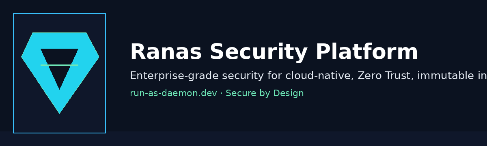
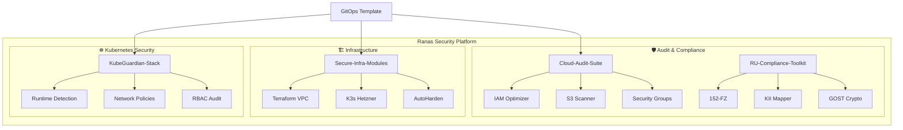
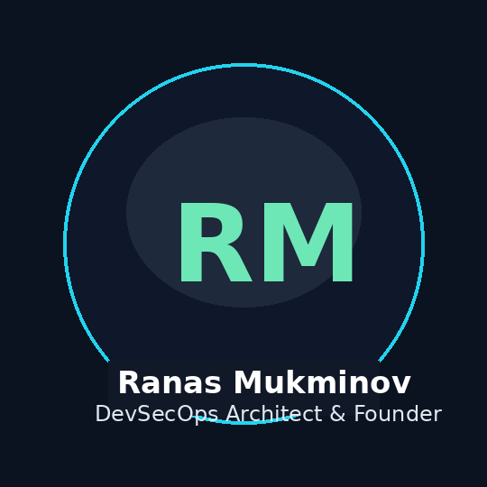

# Ranas Security Platform

**Enterprise-Grade Security Tools for Cloud-Native Infrastructure**

The Ranas Security Platform is a curated ecosystem of security tools built by Ranas Mukminov to help DevSecOps teams, FinTech CTOs, and security engineers ship and operate secure-by-design systems. It unifies cloud posture management, Kubernetes runtime protection, compliance automation, and hardened infrastructure modules under a single governance model.

Modern cloud stacks suffer from misconfigurations, fragmented visibility, and compliance drift. The platform provides repeatable GitOps workflows, pre-hardened infrastructure blueprints, and runtime controls that map to Zero Trust and immutable infrastructure principles. Each component is modular, API-first, and designed to integrate cleanly into existing CI/CD pipelines.

Ranas Security Platform accelerates cloud-native teams that need to satisfy regulatory requirements (CIS, SOC2, 152-FZ), reduce attack surface, and respond quickly to runtime threats—without sacrificing developer velocity.

## Architecture

## Products
| Component | Description | Status | Link |
|-----------|-------------|--------|------|
| Cloud-Audit-Suite | AWS/GCP/Azure security auditing CLI | ✅ Active | [Repository](https://github.com/ranas-mukminov/Cloud-IAM-Optimizer) |
| KubeGuardian-Stack | Kubernetes runtime security | ✅ Active | [Repository](https://github.com/ranas-mukminov/KubeGuardian-Core) |
| Secure-Infra-Modules | Terraform/security hardening modules | 🚧 Beta | [Repository](https://github.com/ranas-mukminov/AutoHarden-Toolkit) |
| RU-Compliance-Toolkit | Russian compliance automation (152-FZ, KII) | ✅ Active | [Repository](https://github.com/ranas-mukminov/152fz-compliance-as-code) |
| Secure-K3s-GitOps-Template | Production-ready K3s template | ✅ Active | [Access Request](https://run-as-daemon.dev/enterprise) |

## Red-team lab portfolio (lab, not production)

The following repositories are lab and methodology work, not
production products. They are public so their scope and limits can
be checked. Nothing here is a client engagement, a real disclosure,
or a production runtime.

| Repository | What it is | Status |
|------------|------------|--------|
| [RedTeam-Engagement-Kit](https://github.com/ranas-mukminov/RedTeam-Engagement-Kit) | Authorised-engagement methodology: scope, rules of engagement, report templates, plus a filled lab-engagement example | Lab / methodology, no exploit code |
| [AI-Red-Lab](https://github.com/ranas-mukminov/AI-Red-Lab) | Local LLM red-teaming lab: 15-case catalogue, stub harness, local-model adapter | Lab, local stub / local models only |
| [VulnLab-App](https://github.com/ranas-mukminov/VulnLab-App) | Intentionally vulnerable local app (SQLi, XSS, IDOR, SSRF, broken auth), 127.0.0.1 only | Lab, intentionally vulnerable — never expose |
| [API-Red-Lab](https://github.com/ranas-mukminov/API-Red-Lab) | OWASP API lab with a localhost HTTP server (BOLA, broken auth, data exposure, rate limiting) | Lab, fictional data only |
| [Cloud-IAM-Red-Lab](https://github.com/ranas-mukminov/Cloud-IAM-Red-Lab) | Simulated cloud IAM privilege-escalation lab (assumption chains, wildcard policies) | Lab, simulated data only, no real cloud |
| [Disclosure-Portfolio](https://github.com/ranas-mukminov/Disclosure-Portfolio) | Responsible-disclosure templates and lab-only sample write-ups | Format / lab samples only, no real CVE claimed |

Existing flagships, for reference: Kube-Simple-Audit, Secure-K3s-GitOps-Template, AutoHarden-Toolkit, Cloud-IAM-Optimizer, and ssh-harden are defensive hardening and audit tools (see their own repositories for their current status). KubeGuardian-Core is a demonstration stub, not a production runtime — see its own README.

## Flagship hardening and audit tools

| Repository | What it is | Status |
|------------|------------|--------|
| [Kube-Simple-Audit](https://github.com/ranas-mukminov/Kube-Simple-Audit) | Lightweight, read-only Bash Kubernetes audit helper with a Markdown report | Audit helper, CI passing |
| [Secure-K3s-GitOps-Template](https://github.com/ranas-mukminov/Secure-K3s-GitOps-Template) | Secure-by-default K3s GitOps template (ArgoCD, Cloudflare Tunnel) | Template, no CI workflow yet |
| [AutoHarden-Toolkit](https://github.com/ranas-mukminov/AutoHarden-Toolkit) | Linux hardening CLI, dry-run by default, v0.2.0 released | CLI, no CI workflow yet |
| [Cloud-IAM-Optimizer](https://github.com/ranas-mukminov/Cloud-IAM-Optimizer) | AWS IAM least-privilege auditor, mocked tests | Audit tool, AWS only, CI passing |
| [ssh-harden](https://github.com/ranas-mukminov/ssh-harden) | SSH hardening helper with audit/apply modes and a lockout guard, v0.1.0 released | Helper, no CI workflow yet |

## Features
- 🔍 Multi-cloud security auditing (AWS, GCP, Azure)
- 🛡️ Kubernetes runtime threat detection
- 📋 Compliance automation (CIS, SOC2, 152-FZ)
- 🏗️ Infrastructure-as-Code security modules
- 🚀 GitOps-ready deployment templates

## Quick Links
- Cloud-Audit-Suite: [Repository](https://github.com/ranas-mukminov/Cloud-IAM-Optimizer) · [Docs](docs/architecture.md#system-overview)
- KubeGuardian-Stack: [Repository](https://github.com/ranas-mukminov/KubeGuardian-Core) · [Runtime Controls](docs/architecture.md#component-interactions)
- Secure-Infra-Modules: [Repository](https://github.com/ranas-mukminov/AutoHarden-Toolkit) · [Roadmap](docs/roadmap.md)
- RU-Compliance-Toolkit: [Repository](https://github.com/ranas-mukminov/152fz-compliance-as-code) · [Compliance Mapping](docs/architecture.md#deployment-models)
- Secure-K3s-GitOps-Template: [Access Request](https://run-as-daemon.dev/enterprise) · [GitOps Flow](docs/architecture.md#component-interactions)

## 🏢 Enterprise

Need custom implementation or dedicated support?

- ✅ Custom security audits
- ✅ On-premise deployment
- ✅ 24/7 support with SLA
- ✅ Compliance consulting (SOC2, ISO27001, 152-FZ)
- ✅ Training & workshops

👉 **Contact:** https://run-as-daemon.dev/enterprise
📅 **Book a call:** https://calendly.com/ranas-security

## Author

- **Ranas Mukminov** — DevSecOps Architect & Founder
- Website: https://run-as-daemon.dev
- LinkedIn: https://www.linkedin.com/in/ranas-mukminov/
- GitHub: https://github.com/ranas-mukminov

## License
MIT License — see [LICENSE](LICENSE).
