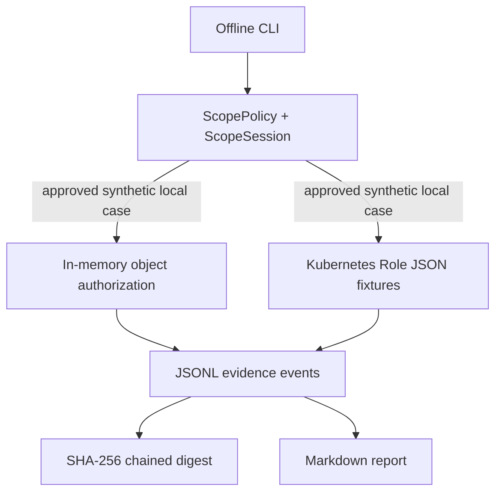

# Architecture and threat model (v0.1)

**Trust boundaries:** This project has no outbound transport and no real authentication authority. All demonstrations run in the local Python process. The URL in the scope declaration is an identifier only; no requests are made to it. The only input artifacts are synthetic data shipped in this repository or a user-provided loopback-only policy.

**Safety properties tested:**

- External targets (domains, IPs, ports) are rejected even if listed by the operator.
- Non-loopback source IPs are rejected, as are unknown methods, expired windows and emergency-stop sessions.
- Action ceilings are enforced before the next simulated action.
- Evidence verification detects editing a record without recomputing subsequent hashes.
- Authorization bypass is reproduced in the in-memory intentionally vulnerable model and rejected after enabling an ownership check.
- Broad Kubernetes RBAC grants are flagged in JSON fixtures, and restricted grants are not flagged.

**Known limitations:** Scope declarations are self-asserted. This project cannot validate ownership or signatures; it does not implement target discovery, scanners, network traffic, exploit delivery, production-safe rate limiting, an HTTP server, real Kubernetes API checks or cryptographic identity binding. An attacker who can rewrite all evidence and its claimed head digest can reconstitute a valid chain; store the final digest separately to meaningfully detect tampering.

**Planned next steps:** signed authorization metadata, independent evidence anchors, better Kubernetes RBAC semantic evaluation, parameterized unit labs, optional localhost-bound HTTP fixture, and a reviewed cross-project contribution process. None are claimed to exist in v0.1.
